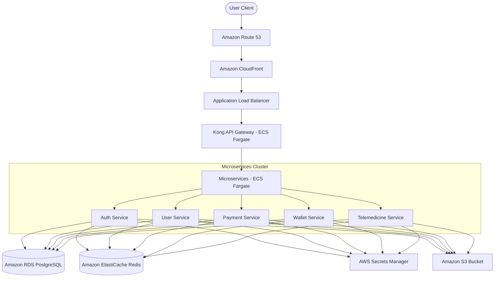

# AWS Deployment & Environment Management Guide

This document details the best-practice setup and cloud architecture for the Ricton backend across **Local**, **Staging**, and **Production (Live)** environments, using Amazon Web Services (AWS) as the cloud service provider.

---

## 1. Environment Variable Architecture & Analysis

### Current Structure: Service-Specific `.env` Files

Currently, the codebase uses individual `.env` files within each service folder (e.g., `services/auth/.env`, `services/wallet/.env`).

#### Is this the right way?

- **For Local Development**: **Yes**. Service-specific `.env` files are appropriate for local development. They prevent environment variables from leaking between services, isolate service ports, and allow developers to boot individual microservices independently.
- **For Staging & Production**: **No**. Staging and production configurations should **never** rely on hardcoded `.env` files on disk. Instead, you should practice **configuration-as-code** and **runtime injection**.

### Production Recommendation (Twelve-Factor App Methodology)

1. **Centralized Secrets Manager**: Use **AWS Secrets Manager** or **AWS Systems Manager Parameter Store** as the single source of truth for all configurations and secrets.
2. **Container Injection**: When deploying services (e.g., via AWS ECS or EKS), inject these variables at the container level directly into the process environment. Do not write `.env` files to the container filesystem.

---

## 2. AWS Architecture Overview

Below is the recommended enterprise-grade AWS architecture for hosting the Ricton API monorepo.

### Key Infrastructure Components:

- **API Gateway**: Kong Gateway deployed on ECS Fargate.
- **Compute Layer**: AWS ECS (Elastic Container Service) with AWS Fargate (serverless containers) to run microservice containers.
- **Database**: Amazon RDS for PostgreSQL (Multi-AZ for high availability).
- **Caching & Queueing**: Amazon ElastiCache for Redis (replaces local Redis containers).
- **Static Assets**: Amazon S3 + CloudFront (for user avatars, prescription files, document uploads).
- **Secrets Management**: AWS Secrets Manager with automatic rotation.

---

## 3. Local, Staging, and Production Environments Setup

### A. Local Development Environment

- **Database & Cache**: Run using Docker Compose locally (`docker-compose.yml` containing PostgreSQL and Redis).
- **Secrets**: Local `.env` files within each service directory.
- **Gateway**: Local Kong Gateway forwarding requests locally.

### B. Staging Environment

- **Compute**: AWS ECS Fargate using low-cost `t3` micro equivalent specs.
- **Database**: Amazon RDS PostgreSQL (Single-AZ, `db.t4g.micro` or `db.t4g.small`).
- **Caching**: Single-node ElastiCache Redis instance.
- **Secrets**: Staging parameters stored in AWS Parameter Store, loaded automatically in ECS Task Definitions.
- **CI/CD**: Auto-deployment on merge to `staging` branch via GitHub Actions.

### C. Production (Live) Environment

- **Compute**: AWS ECS Fargate with Auto Scaling enabled (scale out based on CPU/Memory targets).
- **Database**: Amazon RDS PostgreSQL (Multi-AZ for automatic failover, `db.r6g.large` or larger depending on transaction volume).
- **Caching**: Multi-node ElastiCache Redis Cluster (with replication enabled).
- **Secrets**: Managed via AWS Secrets Manager. Keys encrypted at rest using AWS KMS.
- **CI/CD**: Controlled releases using blue/green deployments (AWS CodeDeploy) on merge to `main` branch.
